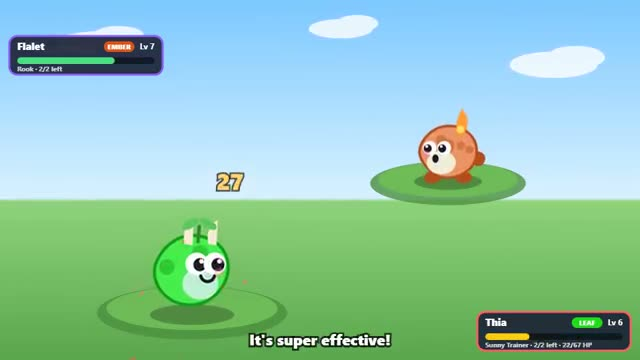

# Monster Tamer

Catch critters in the grass. Battle another tamer. A multiplayer starter game from [Multiplayer Agent](https://multiplayeragent.com): 2D, versus, 2 players, with a bot tamer who battles you when you're alone.

## How it plays

Walk into a wild critter in the tall grass and time your throw to catch it. Then battle another tamer turn by turn: pick a move, mind the types (Ember beats Leaf, Leaf beats Tide, Tide beats Ember), and level up your team.

**Controls:** WASD or arrows to walk (or tap to walk, drag for a thumb stick), tap or Space to throw, tap a move or press 1–4 in battle.

## Make it yours in the Game Builder

Open the [Game Builder](https://multiplayeragent.com), choose **Start from a starter game** and pick Monster Tamer. It opens as version 1 in your studio, ready to play and publish. Then ask for changes, for example:

- Add a water type that lives in the pond
- Let critters evolve into a bigger form at level 10
- Add a shop that sells healing berries

## Run it yourself

1. Get a free publishable key (`pk_…`) at [multiplayeragent.com](https://multiplayeragent.com).
2. In `index.html`, put it in place of `pk_REPLACE_ME` in the `MP_CONNECT` block.
3. Open `index.html` in a browser. No build step and no server needed.

Without a key it still runs, offline against the bot tamer, and your team is kept in this browser.

## How it is built

- One `index.html`. The comment at the top of the script maps the code and explains the multiplayer.
- Every critter is a number: its look, name, type, stats and moves are all drawn and worked out from it.
- **Saves:** Your team and its levels are saved to you, so they're there next time.
- **Host-run rules:** The host's browser runs the wild critters and every battle turn; if it leaves, the next player takes over.
- **Bots:** A bot tamer battles you when you're alone.
- **Live sync:** Both tamers see the same field, the same critters and the same battle.
- **Leaderboard:** Most battles won, shown after every battle.
- `?attract` runs it offline: catch a critter, then battle the bot tamer. The preview video is recorded from it.

## License

MIT.
